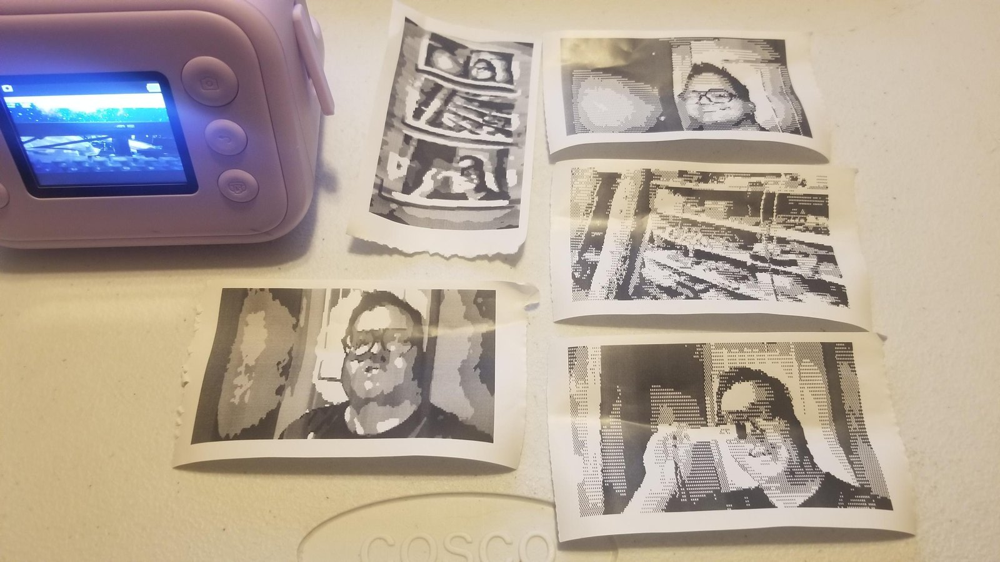
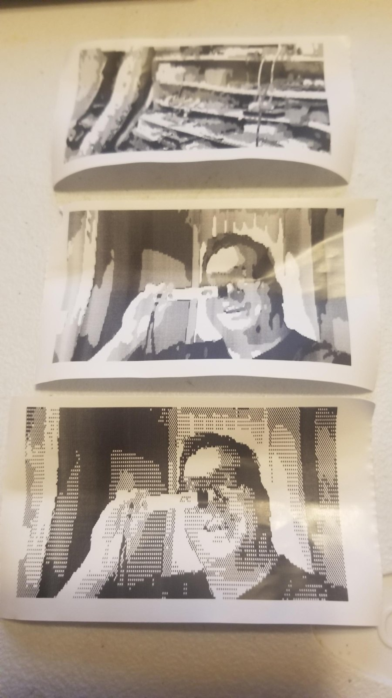
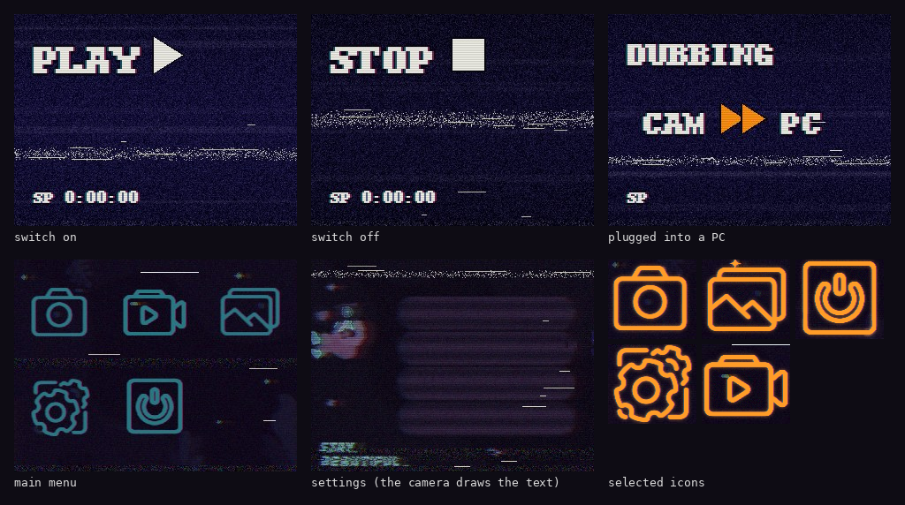

# Receipt Quest

**Mod a kids' thermal-paper instant camera over USB, without opening it.**
New sounds, new screens, new photo frames, and a print effect that runs *inside the camera*:
every print comes out as Sierra-style pixel art with a little glitch damage.

| Pixel-art prints made by the camera itself | Degraded VHS menus and screens |
|---|---|
|  |  |

Every print rolls its own look: **dots** (black and white, dithered like an old adventure
game) or **flat greys** (four grey levels, chunky pixels), with ink outlines, auto
exposure metered on the middle of the picture (where a face usually is), and 0-5 small
glitch hits (slipped lines, smears, stutters, tears, speckle, dragged blocks) that keep
off the middle most of the time. Prints in the gallery's layout can also get an
adventure-game score bar ("Score: 35 of 210 ... >feed hamster_") - see
[docs/PRINTING.md](docs/PRINTING.md) for which prints that is.

## Which camera?

The ones sold everywhere as "kids instant print camera" with 57 mm thermal receipt paper.
This project works on exactly one combination, checked byte for byte before anything is
written:

| | |
|---|---|
| Chip | **AX3291A** (OpenRISC CPU, little-endian) |
| Firmware | **20240822_V1.9** |
| USB, normal mode | `0219:3280`, a USB disk called "Buildwin Media-Player" (the SD card) |
| Flash | GD25Q32, 4 MiB (JEDEC `c8 40 16`) |

Lots of brands sell the same insides. You don't need to know any of this up front: the
first three steps only *look*, make a full backup, and then tell you whether your camera
is byte-for-byte the tested one. If it isn't, nothing gets written (and please open an
issue with what it printed - it contains no firmware, just a list of sector numbers).

Have a different chip or firmware? The [penguin-camera](https://github.com/hidoba/penguin-camera)
project supports the AX3295B "penguin" camera and this camera's MK1-3290-V2 sibling.

## What you can install

| Mod | What it does | Sectors |
|---|---|---|
| `INSTALL_PRINT_EFFECT` | pixel art + glitch prints, done by the camera | 7 |
| `INSTALL_SOUNDS` | 7 new sounds: 4 clicks, shutter, power on, power off | 34 |
| `INSTALL_FRAMES` | 21 new photo frames (VHS, CCTV, receipt, teletext, Sierra...) | 294 |
| `INSTALL_SCREENS_1_MENUS` | degraded-VHS main menu, icons, settings pages | 51 |
| `INSTALL_SCREENS_2_STARTUP` | PLAY / STOP / DUBBING screens for switch on, off, USB | 29 |

Each one installs on its own, and each has an `UNDO_...` that puts those sectors back
exactly as they are in your backup. Your photos, settings and SD card are never touched.
All 21 frames: [examples/frames.jpg](examples/frames.jpg).

## Quick start (Windows)

You need Windows, [Python 3](https://www.python.org/downloads/) (nothing else to install),
the camera's USB cable, and a charged camera battery. Download this project
(green **Code** button, **Download ZIP**), unzip it, open the `install` folder, then:

1. **`1_FIND_CAMERA.bat`** - plug the camera in and switch it on. Looks only.
2. **`2_PREPARE_USB.bat`** - restarts the camera into its chip's built-in loader a few
   times so Windows sets up a driver for it. Writes nothing.
3. **`3_BACKUP.bat`** - reads the whole firmware twice (5-10 minutes), saves it in a
   `firmware_backup_...` folder, and says **YES** or **NO**: is this the tested camera?
   Keep that folder forever. It is your way back.
4. If it said YES: run any `INSTALL_....bat`. About 2 minutes each. Then unplug and try it.

Windows asks "Do you want to allow this app to make changes?" every time - click **Yes**
(it gives up after about 2 minutes). If Windows ever offers to **format** a disk, click
**Cancel**. Step by step, with what each window should say: [docs/INSTALL.md](docs/INSTALL.md).

## How safe is it?

Honest version: it has been run on one camera. Every mod here was installed on it and
verified sector for sector, and the camera has been printing happily since. The undo path
is the same writer with your own backup as the target; it is rehearsed offline (a
simulated camera running the real helper code) but has not been needed on a real one yet.
Writing a camera's firmware always carries some risk. What the tools do about it:

- Nothing is written unless your backup matches the tested firmware in every 4 KiB sector
  (sha256), except the one sector that holds the camera's settings.
- A mod can only rebuild the exact sectors that were tested; their sha256s are in the pack.
- Before writing, the whole flash is read and every sector about to change must be stock,
  already modded, or a half-written copy from an interrupted run. Anything else: stop.
- The little helper program that writes the flash runs on the camera and refuses, by
  itself, to touch anything outside that mod's sectors. It cannot touch the boot code,
  the code that runs at power-on, the resource table or the settings.
- Every sector is erased, programmed, read back and compared; at the end the whole flash
  is read again and must equal "before + exactly the planned sectors".
- The switch-on screen and switch-on sound are written last, so they spend the least
  possible time half-done; the three print hooks are switched over last on install and
  switched back first on undo, so they never point at a half-written effect.

Things that could still go wrong: a different camera that happens to pass the check but
behaves differently (unlikely - the check is byte for byte), or the USB cable/battery
dying in the middle of the start-up screen or sound. If a run stops, **leave the camera
plugged in** and run the same file again; it continues where it stopped. Worst case, the
flash chip can be rewritten from your backup with a cheap SPI programmer and clip. See
[docs/TROUBLESHOOTING.md](docs/TROUBLESHOOTING.md).

## For hackers

How it works, with every address and command we found:

- [docs/HOW_IT_WORKS.md](docs/HOW_IT_WORKS.md) - the USB "ROM door" (0xDA), the loader's
  memory routine (0xCB), the tiny helper programs that read and write the SPI flash, the
  patch packs
- [docs/FLASH_MAP.md](docs/FLASH_MAP.md) - what lives where in the 4 MiB flash, the
  resource table, all 80 resources
- [docs/PRINTING.md](docs/PRINTING.md) - the printer pipeline (56 heat passes, real greys,
  two layouts, Print Density), and how the effect hooks in without touching any code the
  camera runs at power-on
- [docs/MAKING_MODS.md](docs/MAKING_MODS.md) - make your own sounds, frames, screens or
  print effect and turn them into a pack anyone can install
- `make/pc-converter/` - no flashing at all: converts the photos on the SD card into
  pixel-art prints on your PC, then you print them from the gallery

Contributions welcome: other firmware versions, a Linux/macOS port of the USB layer
(it's raw SCSI pass-through on Windows today), new print effects, new packs.

## Credits

Made by Dane Schmidt / GerbilHamsterRecords ([www.gerbilhamsterrecords.com](https://www.gerbilhamsterrecords.com)),
with Claude (Anthropic) doing the reverse engineering and writing the code alongside him.

The boot-ROM loader door (0xDA) and its memory routine (0xCB at 0x00102620) were first
found by the [penguin-camera](https://github.com/hidoba/penguin-camera) project - this
camera's chip ROM turned out to be byte-identical to theirs, which is what made all of
this possible without opening the camera. Thank you.

## License

Non-commercial. Code and docs: PolyForm Noncommercial 1.0.0. Art and sounds: CC BY-NC 4.0.
See [LICENSE.md](LICENSE.md). The camera's firmware is not included and is not ours.
